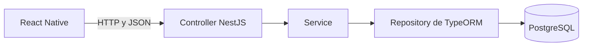

# Cómo funciona el proyecto

Tienes diez aplicaciones independientes dentro de `C04-DATABRIDGE-TYPEORM-POSTGRESQL`. Cada carpeta `EJERCICIO-XX` contiene su backend, su frontend, instrucciones y una base de datos propia.

## Qué hay en cada carpeta

| Carpeta | Aplicación | Qué practicas |
| --- | --- | --- |
| EJERCICIO-01 | Game Vault | Persistir videojuegos y mostrar género |
| EJERCICIO-02 | CineBox | Leer una colección y mostrar favoritas |
| EJERCICIO-03 | Pet Profile | Buscar una mascota por su id |
| EJERCICIO-04 | Food Spots | Crear restaurantes con precio medio |
| EJERCICIO-05 | Travel Book | Modificar solo algunos campos de un viaje |
| EJERCICIO-06 | My Library | Borrar con confirmación y marcar como leído |
| EJERCICIO-07 | Sneaker Vault | CRUD completo y stock numérico |
| EJERCICIO-08 | My Playlists | Relacionar una playlist con sus canciones |
| EJERCICIO-09 | Event Radar | Filtrar por ciudad y categoría |
| EJERCICIO-10 | Wander | Integrar el CRUD y una prioridad persistente |

Los backends utilizan el puerto 3000. Prueba uno cada vez. Las bases se llaman `databridge_e01`, `databridge_e02`, hasta `databridge_e10`.

## Las tres partes principales

**Frontend:** la app de React Native con Expo. Tiene formularios, botones y tarjetas. Pide datos al backend mediante `fetch` y actualiza la pantalla con el estado de React.

**Backend:** la API de NestJS que recibe las peticiones. Comprueba los datos y coordina las consultas y los cambios.

**PostgreSQL:** el servidor que almacena las filas. Los datos se conservan después de cerrar la app o reiniciar NestJS.



La respuesta recorre las capas de vuelta y llega al móvil como JSON.

## Qué significa cada archivo del backend

- **main.ts:** arranca el servidor, habilita CORS y escucha en el puerto 3000.
- **app.module.ts:** configura la conexión a PostgreSQL e importa el módulo del ejercicio.
- **Entity:** describe la tabla y sus columnas. Por ejemplo, Destino tiene ciudad, país, descripción y prioridad.
- **DTO:** describe los campos admitidos al crear o actualizar. El id lo genera la base de datos.
- **Pipe:** valida el JSON de la petición mientras el programa se ejecuta.
- **Controller:** recibe la URL, el método HTTP y los parámetros.
- **Service:** coordina qué buscar, crear, cambiar o borrar.
- **Repository:** ofrece operaciones de TypeORM como `find`, `findOneBy`, `create`, `save`, `merge`, `remove` y `delete`.

`create()` construye un objeto en memoria; `save()` lo guarda. `merge()` aplica cambios al objeto; después hace falta `save()` para persistirlos.

## Las cuatro operaciones CRUD

| Acción | Método HTTP | Ejemplo de Wander |
| --- | --- | --- |
| Consultar | GET | `/destinos` o `/destinos/1` |
| Crear | POST | `/destinos` con JSON |
| Modificar parcialmente | PATCH | `/destinos/1` con los cambios |
| Eliminar | DELETE | `/destinos/1` |

En `/destinos/1`, el 1 es un **Path Param**: identifica el destino.

En `/eventos?ciudad=Zaragoza`, ciudad es un **Query Param**: modifica la consulta.

El **Body** es el JSON enviado, por ejemplo, para crear un destino. Entity y DTO tienen responsabilidades distintas: la Entity representa almacenamiento y el DTO representa la entrada de una operación.

## Ejemplo completo: crear un destino

Escribes Reikiavik, Islandia, una descripción y prioridad alta. Al pulsar Crear destino:

1. La app envía POST `/destinos` con los campos en JSON.
2. El Controller recibe la petición y el Pipe valida los campos del DTO.
3. El Service utiliza el Repository para crear y guardar la Entity.
4. TypeORM realiza la operación en PostgreSQL, que genera el id y almacena la fila.
5. La API devuelve el objeto guardado.
6. La app actualiza la lista y vuelve a consultar GET para sincronizarse con el servidor.

Si después envías PATCH con solo `{"prioridad":"BAJA"}`, los demás campos se conservan. La prioridad sigue guardada tras reiniciar y afecta al orden de la lista.

## Cómo arrancar Wander en tu Mac

Primero prepara PostgreSQL. Elige una de estas opciones:

- Si ya tienes un servidor en el puerto 5432, crea la base `databridge_e10` con `CREATE DATABASE databridge_e10;`.
- Si vas a usar Docker, abre Docker Desktop y, desde `EJERCICIO-10`, ejecuta `docker compose up -d`. Este contenedor utiliza el puerto 5432 y crea la base automáticamente.

En una terminal, arranca el backend:

```sh
cd /Users/gabsitoo/Developer/C04-DATABRIDGE-TYPEORM-POSTGRESQL/EJERCICIO-10/backend
npm run start:dev
```

Para comprobar la API:

```sh
curl -i http://localhost:3000/destinos
```

En `EJERCICIO-10/frontend`, copia `.env.example` a `.env` y sustituye `TU_IP_LOCAL` por la IP del Mac. El móvil y el Mac deben estar en la misma red. En el móvil, `localhost` apunta al propio móvil, por lo que debes utilizar la IP del ordenador.

Abre otra terminal para Expo:

```sh
cd /Users/gabsitoo/Developer/C04-DATABRIDGE-TYPEORM-POSTGRESQL/EJERCICIO-10/frontend
npx expo start
```

Abre el QR con Expo Go. El backend y Expo deben seguir ejecutándose mientras utilizas la app. Las dependencias ya están instaladas en Developer; si haces una copia nueva desde GitHub, ejecuta `npm ci` dentro de backend y de frontend.

Para probar otro ejercicio, detén estos procesos y sigue su README, utilizando su propia base de datos.

## Qué está comprobado y qué falta

Cada ejercicio incluye un archivo `VERIFICACION.md` con sus controles. Las pruebas automatizadas del backend utilizan repositorios simulados y comprueban las peticiones HTTP y la lógica del código.

Queda ejecutar las comprobaciones con PostgreSQL real y abrir las apps en Expo Go. Cada README incluye los SELECT y las peticiones necesarios para comprobar la persistencia.

El código está guardado en tu carpeta Developer y en GitHub. Ejecutar backend, PostgreSQL y Expo es lo que permite utilizar la aplicación.
